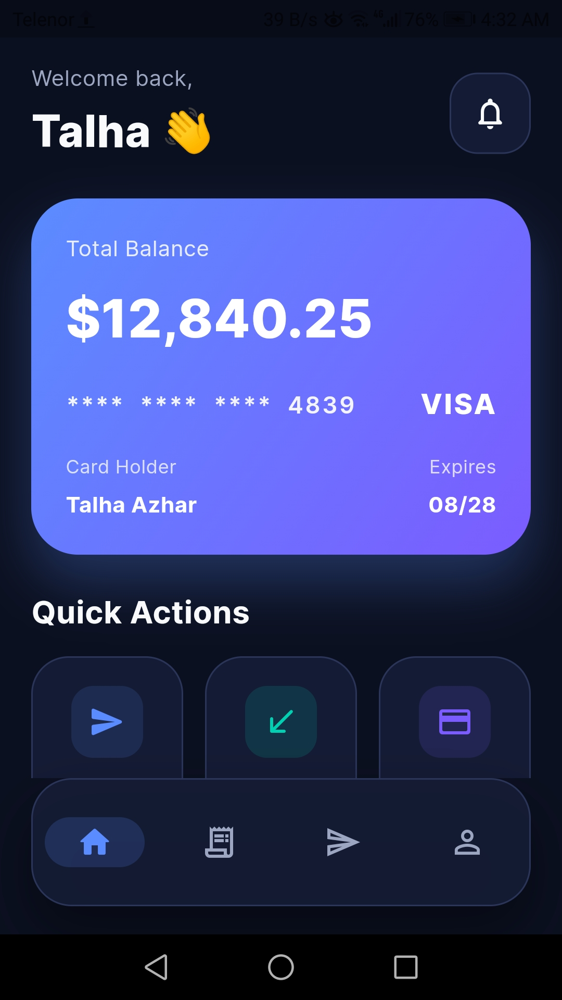
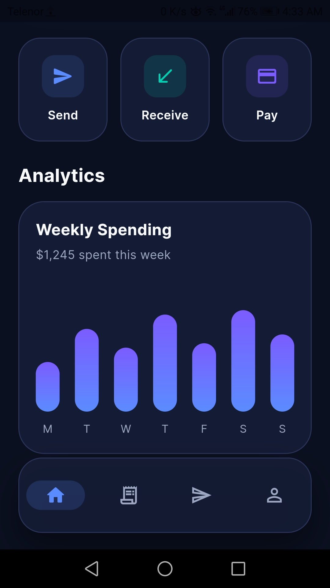
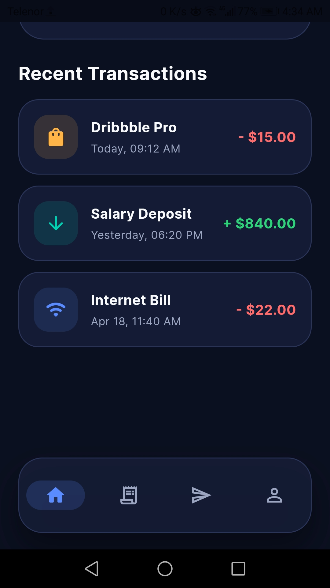
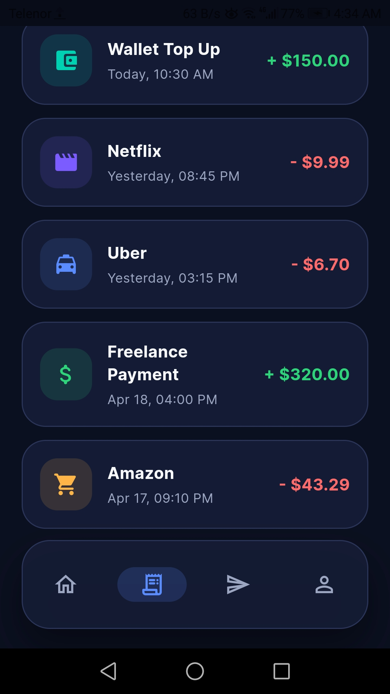
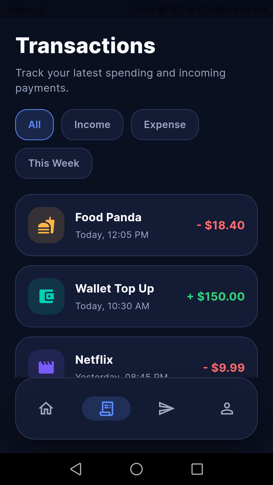
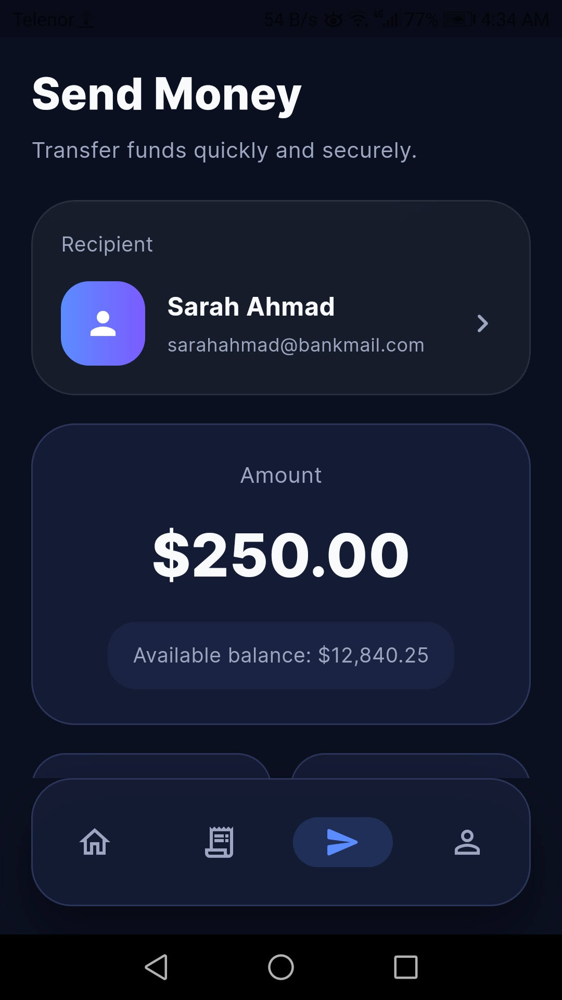
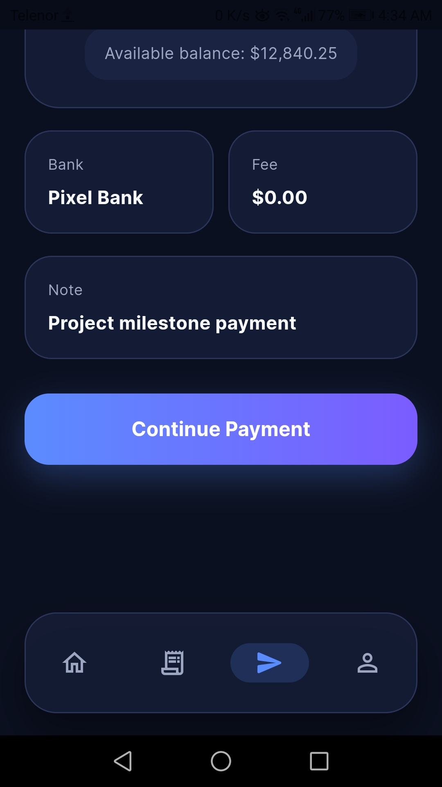
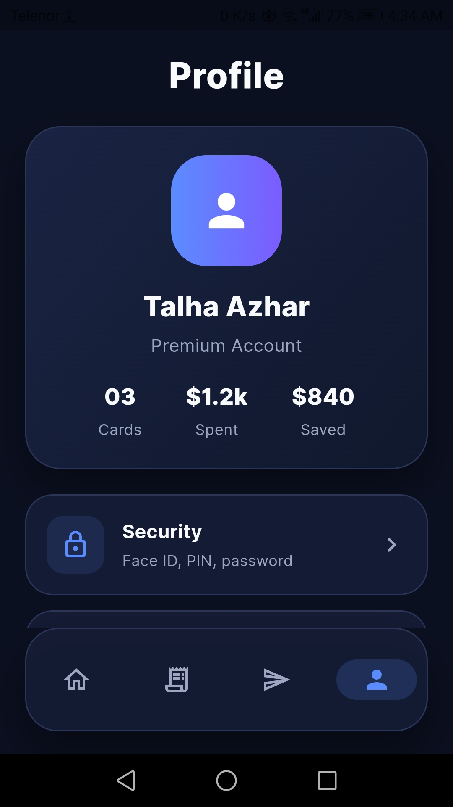
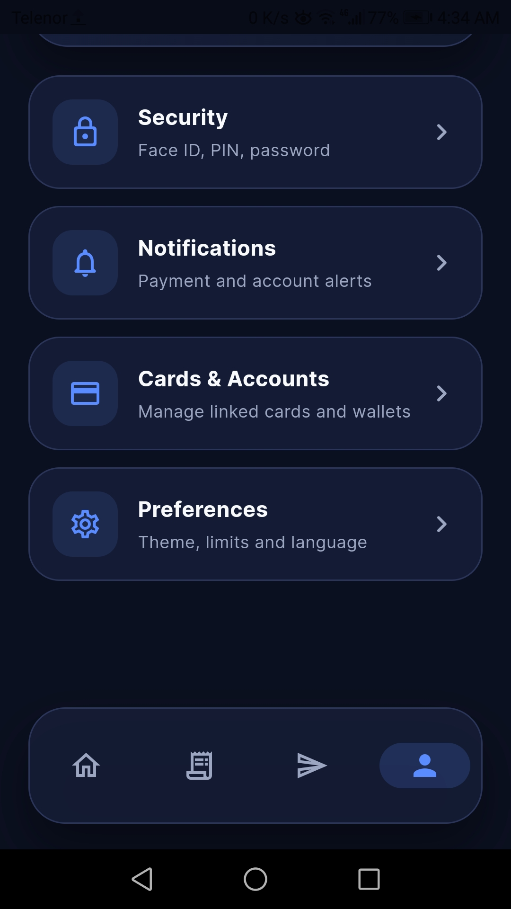

# Flutter Fintech UI

A premium dark fintech Flutter UI built for portfolio and Fiverr client showcase.

## Features
- Dark premium dashboard
- Balance card with gradient design
- Quick actions
- Transaction history screen
- Send money screen
- Profile and settings screen
- Bottom navigation
- Reusable widgets

## Tech Stack
- Flutter
- Dart
- Material 3
- Google Fonts

## Purpose
Built to showcase pixel-perfect Figma/XD/PSD to Flutter conversion skills for modern fintech and banking app interfaces.

## Screenshots

### 💳 Dashboard

---

### 💸 Transactions

---

### 💰 Send Money

---

### 👤 Profile

